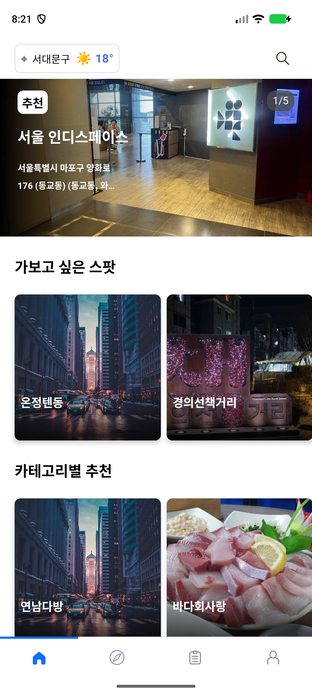
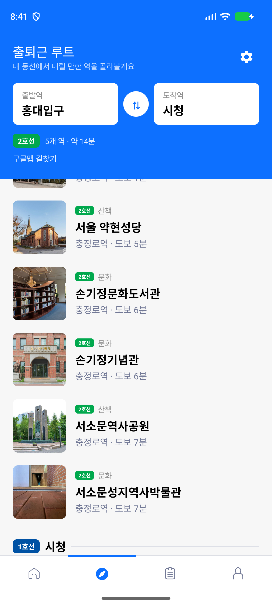
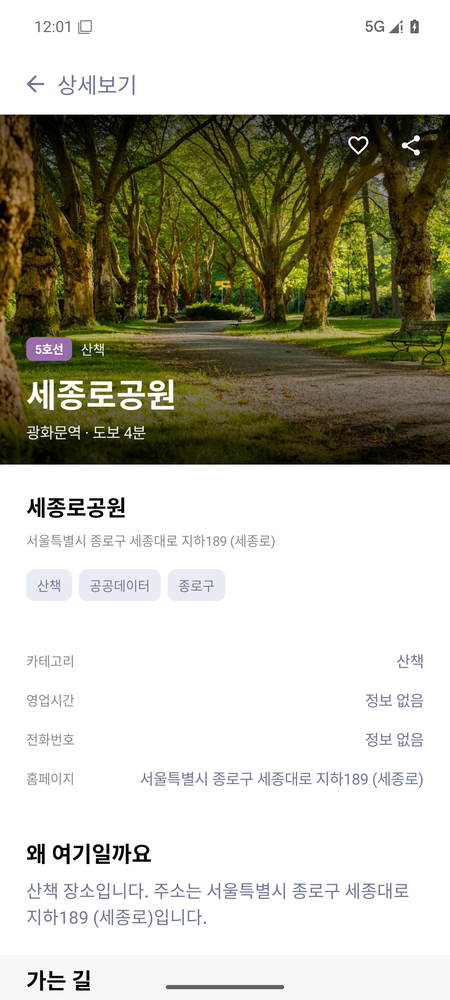
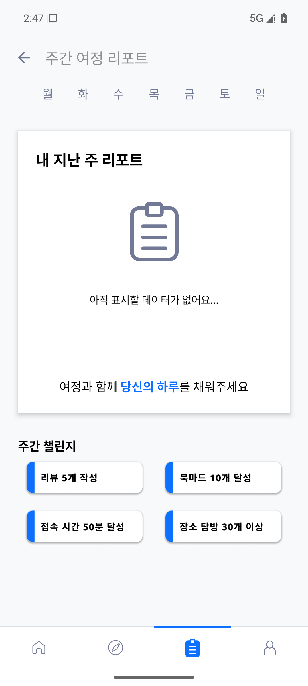

# 여정 · YeoJeong

서울 지하철 출퇴근길, 한 정거장만 내려도 잠깐 쉴 수 있는 곳을 찾아 주는 Android 앱입니다. 출발역과 도착역을 고르면 경로 위 역마다 걸어서 닿는 장소를 묶어 보여 주고, 마음에 든 곳은 저장하고 짧은 키워드 리뷰로 남길 수 있습니다.

| 홈 | 출퇴근 루트 |
|---|---|
|  |  |

| 스팟 상세 | 주간 리포트 |
|---|---|
|  |  |

## 주요 기능

- **온보딩·프로필 설정**: 서비스 소개 5단계, 닉네임·성별·MBTI 입력.
- **홈**: 현재 서울 날씨, 추천 스팟 히어로 카드, 가로 스팟 카드, 대분류·소분류 카테고리 추천.
- **출퇴근 루트**: 출발역·도착역 선택과 역 검색, 자체 지하철 그래프 기반 경로 계산, 경로 위 역별 도보권 장소 추천.
- **스팟 상세**: 카테고리·영업시간·전화·홈페이지, 지도와 주소, TOP3 키워드, 사진 리뷰, 저장·방문·공유.
- **검색**: 장소·역·카테고리·키워드 통합 검색.
- **마이페이지**: 북마크·리뷰·리포트 탭, 프로필·칭호·콜렉션.
- **주간 리포트**: 요일별 방문, 방문 기반 도넛, 저장·리뷰 수, 주간 챌린지 달성 수.
- **설정**: 프로필 수정, 루트 편집, 주 1회 알림, 버전, 약관·개인정보처리방침, 데이터 초기화.

개인 기록은 기기 DataStore에만 저장합니다.

## 기술 스택

| 구분 | 사용 |
|---|---|
| 언어·UI | Kotlin, Jetpack Compose, Material 3 |
| 상태 관리 | ViewModel, StateFlow, Coroutines |
| 저장 | DataStore (Preferences) |
| 네트워크 | HttpURLConnection, org.json |
| 이미지 | Coil |
| 빌드 | Gradle, minSdk 26 / targetSdk 36 / JDK 17 |

## 프로젝트 구조

```
.
├─ yeojeong-native/     # Android 앱 (Kotlin, Compose)
│  ├─ app/src/main/java/com/tts/yeojeong/
│  │  ├─ ui/            # 화면, 컴포넌트, 테마
│  │  ├─ vm/            # ViewModel, 상태 조합
│  │  ├─ data/          # 지하철·장소·날씨·설정 저장소
│  │  └─ model/         # 도메인 모델
│  └─ screenshots/      # 화면 캡처
└─ design_system/       # 디자인 토큰, 가이드, 스타일 타일
```

## 실행

요구 사항은 JDK 17 이상, Android SDK Platform 36, Build-Tools 36.0.0입니다.

`yeojeong-native/local.properties`에 SDK 경로와 공공데이터 키를 넣습니다. 키가 없으면 장소는 내장 시드로, 날씨는 Open-Meteo로 대체됩니다.

```properties
sdk.dir=C:/Users/<user>/AppData/Local/Android/sdk
PUBLIC_DATA_API_KEY=...
KMA_API_KEY=...
```

```powershell
cd yeojeong-native
.\gradlew.bat :app:assembleDebug
```

결과물은 `yeojeong-native/app/build/outputs/apk/debug/app-debug.apk`입니다.

## 데이터

- **장소**: 한국관광공사 TourAPI `KorService2`의 `locationBasedList2`·`searchKeyword2`. 네트워크가 없을 때는 내장 시드(`tour_seed.json`, `tour_cafe_seed.json`)를 사용합니다.
- **날씨**: 기상청 초단기예보 `getUltraSrtFcst`, 실패 시 Open-Meteo.
- **지하철**: `capitalStations.json` 역·노선 그래프와 `subwayPos.json` 좌표. 수도권 연결 정보는 [iml1111/Korea-Subway](https://github.com/iml1111/Korea-Subway)(MIT)를 바탕으로 정규화했습니다.
- **사진**: Unsplash License. 자세한 출처는 [CREDITS](yeojeong-native/CREDITS.md)에 정리했습니다.

## 디자인

화면 규칙은 [디자인 가이드](design_system/여정_디자인_가이드.md)와 [디자인 토큰](design_system/tokens.json)을 따릅니다. 토큰을 시각적으로 확인하려면 `design_system/style_tile.html`을 열면 됩니다.

- 캔버스 `#FFFFFF`, 보조 배경 `#F7F7F7`, 브랜드 `#0D70FF`
- 본문 16sp, 보조 14sp, 캡션 12sp, 섹션 제목 20sp bold
- 화면 좌우·카드 패딩 20dp, 섹션 간격 16dp, 컨트롤 모서리 8dp
- 하단 CTA 56dp, 하단 내비게이션 56dp

## 라이선스

소스 코드는 포트폴리오 목적으로 공개합니다. 외부 데이터와 이미지는 각 출처의 약관과 라이선스를 따릅니다.
