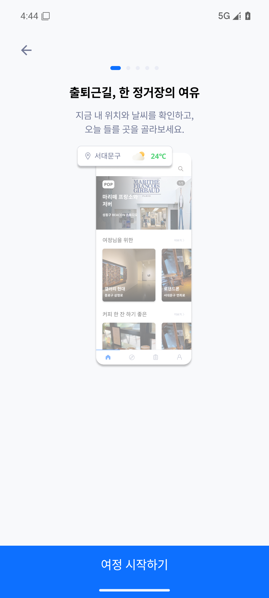
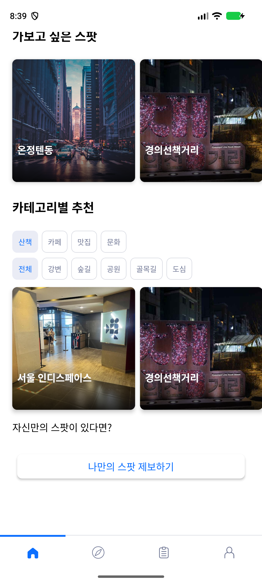
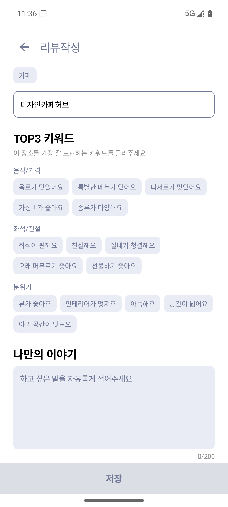
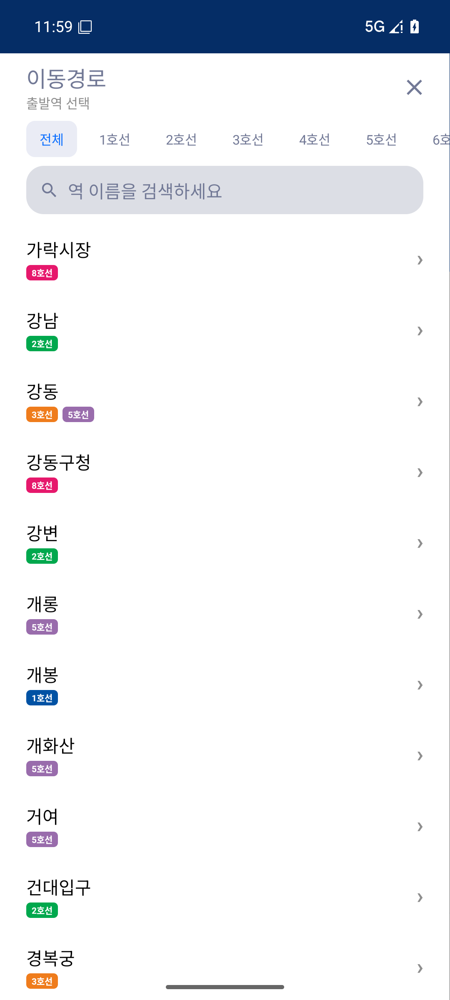
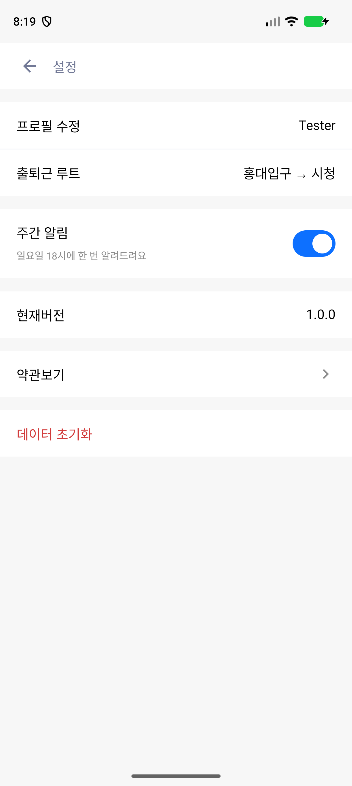
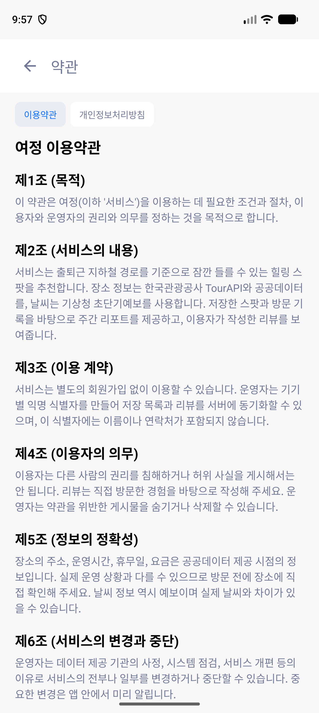

# 여정 Android 앱

서울 지하철 출퇴근 동선에서 잠깐 들를 수 있는 힐링 스팟을 찾는 서비스 **여정**의 Android 앱입니다. Kotlin과 Jetpack Compose로 만들었고, 개인 기록은 기기 DataStore에만 저장합니다.

장소는 **TourAPI**를 1차 데이터로 사용하고, 날씨는 **기상청 초단기예보**를 우선 사용합니다. 키가 없거나 네트워크가 끊기면 Open-Meteo와 로컬 시드로 대체합니다.

## 기능

- **온보딩**: 5개 페이지 소개와 “여정 시작하기”.
- **로그인**: 로고와 카카오·구글 버튼 배치를 유지한 진입 화면. 계정 서버 없이 다음 단계로 넘어갑니다.
- **홈**: 서울 날씨, 추천 스팟 히어로, 가로 스팟 카드, 대분류·소분류 카테고리 추천, “나만의 스팟 제보하기”.
- **출퇴근 루트**: 출발역·도착역 선택과 역 검색, 경로 계산, 경로 위 역별 도보권 장소 추천.
- **스팟 상세**: 대표 이미지, 카테고리·영업시간·전화·홈페이지, 지도·주소, TOP3 키워드, 사진 리뷰, 저장·방문·공유.
- **마이페이지**: 북마크·리뷰·리포트 3탭, 프로필·칭호·콜렉션.
- **주간 리포트**: 요일별 방문, 방문 기반 도넛, 저장·리뷰 수, 주간 챌린지 달성 수.
- **검색**: 장소·역·카테고리·키워드 검색.
- **설정**: 프로필 수정, 루트 편집, 주 1회 알림, 버전, 약관·개인정보처리방침, 데이터 초기화.

## 구조

```
app/src/main/java/com/tts/yeojeong/
  MainActivity.kt
  ui/YeojeongApp.kt          # Navigation + bottom bar + system bars
  ui/theme/                  # color, type, shapes, theme
  ui/components/             # header, CTA, input, badge, cards, bottom nav
  ui/screens/                # onboarding, home, route, detail, saved, report, search, settings, terms
  vm/YeojeongViewModel.kt    # StateFlow + DataStore + route/weather orchestration
  data/AppPreferences.kt     # DataStore, saved/visited state
  data/SubwayRepository.kt   # JSON graph loading + route planner
  data/TourApiRepository.kt  # TourAPI KorService2 + offline seed cache
  data/WeatherRepository.kt  # KMA ultra-short forecast -> Open-Meteo fallback
  data/SampleSpots.kt        # curated Seoul healing spots
  model/Models.kt
```

### 경로 탐색

`SubwayRepository`는 앱 asset의 역·노선 그래프를 읽어 역 수와 환승을 비용으로 두고 최소 비용 경로를 계산합니다. 역 좌표 거리로 소요 시간을 구하고, 1~9호선과 수도권 지선을 포함합니다. 지선·분기 구간은 운영 순서와 다를 수 있으므로 노선 개편 시 자산을 갱신해야 합니다.

추천은 경로 위 역을 몇 곳 골라 각 역 주변 장소를 조회하고, 가장 가까운 역이 해당 역인 장소만 묶어 보여 줍니다. “한 정거장 내려서 조금 걸어가면 쉴 수 있는 곳”이 역별 섹션으로 표시됩니다.

### 데이터

- **장소**: TourAPI `locationBasedList2`, `searchKeyword2`를 실시간 호출합니다. 네트워크가 없을 때를 위해 `tour_seed.json`(100건), `tour_cafe_seed.json`(24건)을 asset에 캐시했습니다.
- **장소-역 매핑**: TourAPI 좌표에서 가장 가까운 지하철역을 계산해 도보 시간과 역 배지를 만듭니다.
- **날씨**: 기상청 `getUltraSrtFcst`를 먼저 호출하고, 키가 없거나 만료되면 Open-Meteo로 대체합니다.
- **지하철**: `capitalStations.json` 그래프와 `subwayPos.json` 좌표.

### 공공데이터 키

`local.properties`에 키를 넣으면 `BuildConfig`로 주입됩니다. 저장소에는 키를 커밋하지 않습니다.

```properties
PUBLIC_DATA_API_KEY=...
KMA_API_KEY=...
```

TourAPI는 `KorService2`를 사용합니다. 운영 배포 전에는 키를 재발급하고 서버 프록시로 옮기는 편이 안전합니다.

## 빌드

- JDK 17 이상
- Android SDK Platform 36, Build-Tools 36.0.0

`local.properties`의 `sdk.dir`이 로컬 SDK를 가리키도록 설정한 뒤 빌드합니다.

```powershell
.\gradlew.bat :app:assembleDebug
```

릴리스 빌드는 R8 축소·난독화를 켭니다. 서명은 별도 keystore로 진행합니다.

## 화면

| 온보딩 | 홈 |
|---|---|
|  |  |

| 출퇴근 루트 | 스팟 상세 |
|---|---|
|  |  |

| 카테고리 | 주간 리포트 |
|---|---|
|  |  |

| 리뷰 작성 | 역 선택 |
|---|---|
|  |  |

| 설정 | 약관·개인정보처리방침 |
|---|---|
|  |  |

## 검증

- `assembleDebug`, `assembleRelease`(R8 축소) 빌드 확인.
- Android 36 Google APIs x86_64 에뮬레이터에서 온보딩 → 로그인 → 프로필 설정 → 홈 → 루트 → 마이페이지 → 설정 → 약관 흐름 확인.
- 홍대입구 → 시청 경로에서 여러 역의 추천이 각각 표시되는 것 확인.
- 홈의 대분류·소분류 선택에 따라 카드가 필터링되는 것 확인.
- 저장·방문 기록과 리뷰가 DataStore에 남고 화면에 즉시 반영되는 것 확인.
- 주간 알림이 주 1회로 예약되고 재부팅 후 다시 예약되는 것 확인.

## 운영 전 남은 일

- **계정**: 로그인 화면은 진입 화면입니다. 실제 로그인이 필요해지면 인증 SDK를 붙입니다.
- **리뷰 사진**: 기기 URI만 저장합니다. 서버 업로드는 인증을 붙인 뒤 진행합니다.
- **API 키**: 현재 TourAPI·기상청 키는 `BuildConfig`에 있습니다. 운영 전 서버 프록시로 옮기는 편이 안전합니다.
- **노선 데이터**: 지선·분기 구간은 운영 순서와 다를 수 있어 개편 때마다 자산을 갱신해야 합니다.
- **알림**: 주간 알림은 `POST_NOTIFICATIONS` 권한과 `AlarmManager` 예약으로 동작합니다. 서버 푸시는 사용하지 않습니다.
- **다국어**: 한국어 전용이라 화면 문구를 코드에 두었습니다. 필요하면 `strings.xml`로 이전합니다.

